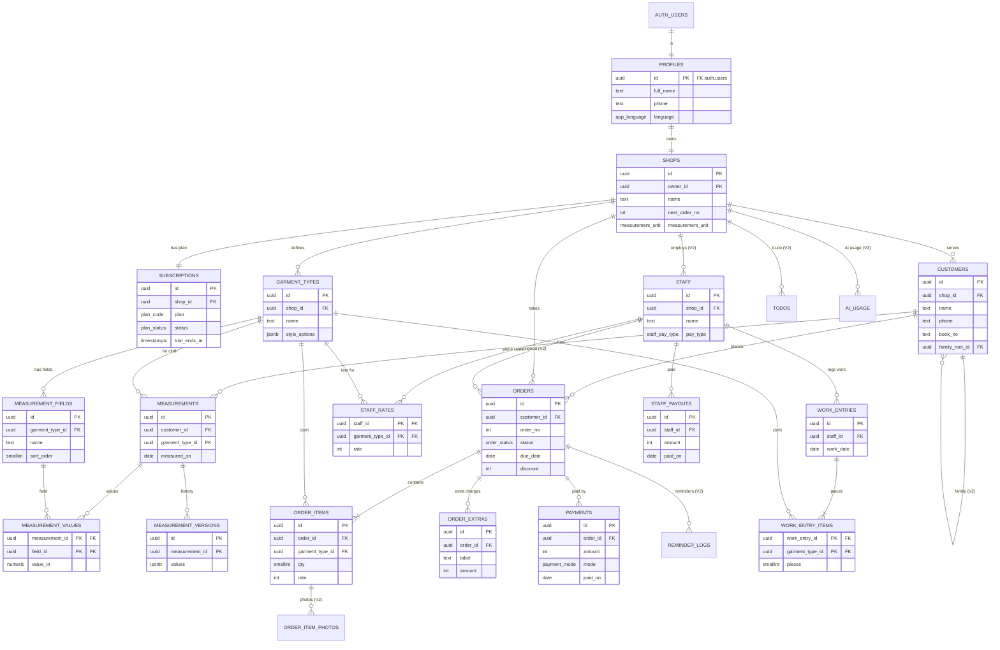

# TrueFit — Database Design

> Reads from **PRD.md** and **ARCHITECTURE.md**. Server: **Supabase Postgres 15** (schema `public`). Device: **SQLite** (Drizzle) mirrors the same tables and columns for offline use (SQLite types: `uuid`→TEXT, `timestamptz`/`date`→TEXT ISO, `numeric`→REAL, `boolean`→INTEGER, `jsonb`→TEXT).

## 1. Conventions
- Table names: plural `snake_case`. Columns `snake_case`. FK columns `<singular>_id`.
- Primary keys: `id uuid` — generated **on the device** (UUID v4) so rows can be created offline; server default `gen_random_uuid()` for server-created rows.
- Every table has `created_at timestamptz not null default now()` and `updated_at timestamptz not null default now()`. A trigger `set_updated_at()` sets `updated_at = now()` on every insert and update (server time is the sync cursor).
- **Soft delete:** synced business tables have `deleted_at timestamptz null`. Rows are never hard-deleted by the app (needed for offline sync tombstones and Undo). Hard delete happens only in account deletion (cascade) and data-retention jobs.
- Every business row carries `shop_id` (denormalised) so Row Level Security is a single indexed check.
- Money: `integer` rupees (no paise in MVP). Measurements: `numeric(6,2)` stored in **inches** (cm converted for display only).
- Enums are Postgres `enum` types (stored as TEXT with CHECK in SQLite).

### Enum types
| Type | Values |
|---|---|
| `app_language` | `en`, `gu`, `hi` |
| `measurement_unit` | `in`, `cm` |
| `order_status` | `received`, `ready`, `delivered` |
| `payment_mode` | `cash`, `upi`, `card` |
| `plan_code` | `trial`, `pro_monthly`, `pro_yearly` |
| `plan_status` | `trialing`, `active`, `grace`, `expired`, `cancelled` |
| `staff_pay_type` (V2) | `piece`, `monthly` |
| `reminder_kind` (V2) | `pickup`, `payment`, `delay` |

## 2. Tables — MVP

### 2.1 `profiles` — one per signed-in owner (1:1 with `auth.users`)
| Column | Type | Constraints / default |
|---|---|---|
| id | uuid | **PK**, **FK → auth.users(id) on delete cascade** |
| full_name | text | not null, check `char_length(full_name) between 2 and 60` |
| email | text | null (copied from auth) |
| phone | text | null, check `phone ~ '^[6-9][0-9]{9}$'` |
| language | app_language | not null default `'en'` |
| created_at / updated_at | timestamptz | not null default now() |
Created by trigger `on_auth_user_created` with `full_name` from metadata (or "Owner").

### 2.2 `shops` — one shop per owner (MVP)
| Column | Type | Constraints / default |
|---|---|---|
| id | uuid | **PK** default gen_random_uuid() |
| owner_id | uuid | not null, **FK → profiles(id) on delete cascade**, **unique** (one shop per owner) |
| name | text | not null, check length 2–40 |
| phone | text | null, check 10-digit Indian mobile |
| gstin | text | null, check `gstin ~ '^[0-9]{2}[A-Z]{5}[0-9]{4}[A-Z][1-9A-Z]Z[0-9A-Z]$'` |
| upi_id | text | null, check `upi_id ~ '^[\w.\-]{2,}@[A-Za-z][A-Za-z0-9]+$'` |
| default_gst_rate | smallint | not null default 0, check in (0,5,12,18) |
| measurement_unit | measurement_unit | not null default `'in'` |
| weekly_off_day | smallint | null, check between 0 and 6 (0 = Sunday) |
| next_order_no | integer | not null default 1001, check > 0 |
| created_at / updated_at / deleted_at | timestamptz | deleted_at null |

### 2.3 `subscriptions` — plan state per shop (written only by server)
| Column | Type | Constraints / default |
|---|---|---|
| id | uuid | **PK** |
| shop_id | uuid | not null, **FK → shops(id) on delete cascade**, **unique** |
| plan | plan_code | not null default `'trial'` |
| status | plan_status | not null default `'trialing'` |
| trial_ends_at | timestamptz | not null default now() + interval '30 days' |
| current_period_end | timestamptz | null |
| provider | text | not null default `'revenuecat'` |
| provider_customer_id | text | null (RevenueCat app_user_id = profiles.id) |
| last_event_id | text | null (idempotency for webhooks) |
| created_at / updated_at | timestamptz | |

### 2.4 `garment_types` — cloth types (Shirt, Pant, …)
| Column | Type | Constraints / default |
|---|---|---|
| id | uuid | **PK** |
| shop_id | uuid | not null, **FK → shops(id) on delete cascade** |
| name | text | not null, check length 2–30 |
| sort_order | smallint | not null default 0 |
| style_options | jsonb | not null default `'{}'` — `{"Collar":["Regular","Mandarin"],"Fit":["Slim"]}` |
| fabric_per_piece_m | numeric(4,1) | not null default 0, check between 0 and 20 |
| created_at / updated_at / deleted_at | timestamptz | |
Unique: `(shop_id, lower(name)) where deleted_at is null`.

### 2.5 `measurement_fields` — fields per cloth type
| Column | Type | Constraints / default |
|---|---|---|
| id | uuid | **PK** |
| shop_id | uuid | not null, FK → shops(id) on delete cascade |
| garment_type_id | uuid | not null, **FK → garment_types(id) on delete cascade** |
| name | text | not null, check length 1–30 |
| sort_order | smallint | not null default 0 |
| created_at / updated_at / deleted_at | timestamptz | |
Unique: `(garment_type_id, lower(name)) where deleted_at is null`.

### 2.6 `customers`
| Column | Type | Constraints / default |
|---|---|---|
| id | uuid | **PK** |
| shop_id | uuid | not null, FK → shops(id) on delete cascade |
| name | text | not null, check length 2–50 |
| phone | text | not null, check `^[6-9][0-9]{9}$` |
| book_no | text | null, check length ≤ 12 |
| area | text | null, check length ≤ 100 |
| family_root_id | uuid | null, **FK → customers(id)** (V2 families; null in MVP) |
| created_at / updated_at / deleted_at | timestamptz | |
Phone and book_no are **not unique** in the DB (family members share them, V2). The app warns on duplicates.

### 2.7 `measurements` — current measurement of one customer for one cloth
| Column | Type | Constraints / default |
|---|---|---|
| id | uuid | **PK** |
| shop_id | uuid | not null, FK → shops(id) on delete cascade |
| customer_id | uuid | not null, **FK → customers(id) on delete cascade** |
| garment_type_id | uuid | not null, **FK → garment_types(id)** |
| notes | text | null, check length ≤ 300 |
| measured_on | date | not null default current_date |
| created_at / updated_at / deleted_at | timestamptz | |
Unique: `(customer_id, garment_type_id) where deleted_at is null` (one current set per cloth).

### 2.8 `measurement_values` — one value per field (many-to-many measurements ↔ fields)
| Column | Type | Constraints / default |
|---|---|---|
| measurement_id | uuid | **PK part**, **FK → measurements(id) on delete cascade** |
| field_id | uuid | **PK part**, **FK → measurement_fields(id) on delete cascade** |
| shop_id | uuid | not null, FK → shops(id) on delete cascade |
| value_in | numeric(6,2) | not null, check `value_in > 0 and value_in <= 999.99` |
| created_at / updated_at / deleted_at | timestamptz | |
Primary key `(measurement_id, field_id)`.

### 2.9 `measurement_versions` — history snapshots (append-only)
| Column | Type | Constraints / default |
|---|---|---|
| id | uuid | **PK** |
| shop_id | uuid | not null, FK → shops(id) on delete cascade |
| measurement_id | uuid | not null, **FK → measurements(id) on delete cascade** |
| values | jsonb | not null — `{"<field_id>": 40.0, ...}` (values before the change) |
| notes | text | null |
| measured_on | date | not null |
| created_at / updated_at | timestamptz | |
App keeps the latest 10 versions per measurement (older rows removed by a nightly job).

### 2.10 `orders`
| Column | Type | Constraints / default |
|---|---|---|
| id | uuid | **PK** |
| shop_id | uuid | not null, FK → shops(id) on delete cascade |
| customer_id | uuid | not null, **FK → customers(id)** (restrict; customers are soft-deleted) |
| order_no | integer | not null, check > 0 |
| status | order_status | not null default `'received'` |
| order_date | date | not null default current_date |
| due_date | date | not null, check `due_date >= order_date` |
| is_urgent | boolean | not null default false |
| notes | text | null, check length ≤ 500 |
| discount | integer | not null default 0, check ≥ 0 |
| gst_rate | smallint | not null default 0, check in (0,5,12,18) |
| ready_on | date | null |
| delivered_on | date | null, check `(status = 'delivered') = (delivered_on is not null)` |
| cancelled_at | timestamptz | null |
| cancel_reason | text | null, check length ≤ 120 |
| staff_id | uuid | null, FK → staff(id) (V2; column added in migration 0010) |
| created_via | text | not null default `'app'`, check in ('app','ai') |
| created_at / updated_at / deleted_at | timestamptz | |
Unique: `(shop_id, order_no)`.

### 2.11 `order_items`
| Column | Type | Constraints / default |
|---|---|---|
| id | uuid | **PK** |
| shop_id | uuid | not null, FK → shops(id) on delete cascade |
| order_id | uuid | not null, **FK → orders(id) on delete cascade** |
| garment_type_id | uuid | not null, **FK → garment_types(id)** |
| qty | smallint | not null, check between 1 and 50 |
| rate | integer | not null, check between 0 and 200000 (no default: entered by the owner) |
| styles | jsonb | not null default `'{}'` — `{"Collar":"Mandarin"}` |
| note | text | null, check length ≤ 120 |
| sort_order | smallint | not null default 0 |
| created_at / updated_at / deleted_at | timestamptz | |

### 2.12 `order_extras` — extra charges (lining, embroidery, urgent fee)
| Column | Type | Constraints / default |
|---|---|---|
| id | uuid | **PK** |
| shop_id | uuid | not null, FK → shops(id) on delete cascade |
| order_id | uuid | not null, **FK → orders(id) on delete cascade** |
| label | text | not null, check length 1–40 |
| amount | integer | not null, check between 1 and 200000 |
| created_at / updated_at / deleted_at | timestamptz | |

### 2.13 `payments` — advances, balance payments, refunds (negative)
| Column | Type | Constraints / default |
|---|---|---|
| id | uuid | **PK** |
| shop_id | uuid | not null, FK → shops(id) on delete cascade |
| order_id | uuid | not null, **FK → orders(id) on delete cascade** |
| amount | integer | not null, check `amount <> 0 and abs(amount) <= 1000000` |
| mode | payment_mode | not null default `'cash'` |
| paid_on | date | not null default current_date |
| note | text | null, check length ≤ 80 |
| created_at / updated_at / deleted_at | timestamptz | |

### 2.14 View `order_totals` (read-only, for server-side reporting; the app computes the same locally)
`order_id, shop_id, subtotal = Σ qty×rate, extras = Σ amount, base = max(0, subtotal + extras − discount), tax = round(base × gst_rate / 100), total = base + tax, paid = Σ payments, balance = case when cancelled then 0 else greatest(0, total − paid)` — only non-deleted child rows. Defined `with (security_invoker = true)` so RLS of the base tables applies.

## 3. Tables — V2 (created in later migrations)

### 3.1 `staff` (records only, no login)
`id uuid PK` · `shop_id uuid not null FK shops` · `name text not null (2–50)` · `role text not null default 'Karigar'` · `phone text null` · `pay_type staff_pay_type not null default 'piece'` · `monthly_salary integer not null default 0 check ≥ 0` · `is_active boolean not null default true` · `created_at/updated_at/deleted_at`.

### 3.2 `staff_rates` — piece rate per staff per cloth (many-to-many staff ↔ garment_types)
`staff_id uuid PK part FK staff on delete cascade` · `garment_type_id uuid PK part FK garment_types on delete cascade` · `shop_id uuid not null` · `rate integer not null check between 0 and 100000` · `created_at/updated_at/deleted_at`. PK `(staff_id, garment_type_id)`.

### 3.3 `work_entries` and `work_entry_items`
`work_entries`: `id uuid PK` · `shop_id` · `staff_id uuid not null FK staff` · `work_date date not null check ≤ current_date` · `note text null (≤ 80)` · `created_via text default 'app'` · timestamps + deleted_at.
`work_entry_items`: `work_entry_id uuid PK part FK work_entries on delete cascade` · `garment_type_id uuid PK part FK garment_types` · `shop_id` · `pieces smallint not null check between 1 and 500` · `rate_at_entry integer not null` (rate copied so later rate changes don't rewrite history) · timestamps + deleted_at.

### 3.4 `staff_payouts`
`id uuid PK` · `shop_id` · `staff_id uuid not null FK staff` · `amount integer not null check > 0` · `mode payment_mode not null default 'cash'` · `paid_on date not null` · `note text null` · timestamps + deleted_at.

### 3.5 `order_item_photos`
`id uuid PK` · `shop_id` · `order_item_id uuid not null FK order_items on delete cascade` · `storage_path text not null` (`{shop_id}/{order_id}/{item_id}/{id}.jpg` in bucket `order-photos`) · `sort_order smallint default 0` · timestamps + deleted_at. Max 4 per item (enforced by trigger).

### 3.6 `reminder_logs`
`id uuid PK` · `shop_id` · `order_id uuid not null FK orders on delete cascade` · `kind reminder_kind not null` · `sent_on date not null default current_date` · timestamps. Unique `(order_id, kind, sent_on)`.

### 3.7 `todos`
`id uuid PK` · `shop_id` · `text text not null (1–80)` · `done_at timestamptz null` · timestamps + deleted_at.

### 3.8 `ai_usage` (server-only, append-only)
`id uuid PK` · `shop_id uuid not null FK shops on delete cascade` · `input_tokens integer not null` · `output_tokens integer not null` · `tool_calls smallint not null default 0` · `created_at/updated_at`. Used for per-shop rate limits and cost tracking. **No chat text is stored.**

### 3.9 Device-only tables (SQLite, never synced)
- `outbox` — `id integer PK autoincrement`, `table_name text not null`, `row_id text not null`, `op text not null check in ('upsert')`, `payload text not null` (JSON), `attempts integer not null default 0`, `last_error text null`, `created_at text not null`, `updated_at text not null`. Index `(created_at)`.
- `sync_cursors` — `table_name text PK`, `cursor_updated_at text not null`, `cursor_id text not null`, `created_at`, `updated_at`.
These support offline sync (ARCHITECTURE.md §3) and have no server counterpart or RLS.

## 4. Relationships
- **One-to-one:** `auth.users` ↔ `profiles` (same id). `profiles` ↔ `shops` (unique `owner_id`, MVP). `shops` ↔ `subscriptions` (unique `shop_id`).
- **One-to-many:** shop → garment_types, customers, orders, payments, staff, todos (all via `shop_id`); garment_type → measurement_fields; customer → measurements, orders; measurement → measurement_versions; order → order_items, order_extras, payments, reminder_logs; order_item → order_item_photos; staff → work_entries, staff_payouts, orders (assigned); work_entry → work_entry_items; customer → customers (family members via `family_root_id`, self-reference, V2).
- **Many-to-many:**
  - `measurements` ↔ `measurement_fields` through **`measurement_values`** (a measurement has many field values; a field appears in many measurements).
  - `staff` ↔ `garment_types` through **`staff_rates`** (V2).
  - `work_entries` ↔ `garment_types` through **`work_entry_items`** (V2).
  - `orders` ↔ `garment_types` through **`order_items`** (an item also carries qty, rate, styles).

## 5. ER diagram


(All tables also have `created_at`, `updated_at`; soft-deletable tables have `deleted_at`.)

## 6. Indexes (most common queries)
| Index | Query it serves |
|---|---|
| `<every synced table> (shop_id, updated_at, id)` | Sync pull: rows changed since cursor |
| `orders (shop_id, status, due_date) where deleted_at is null and cancelled_at is null` | Active orders, late, due today, Today's work |
| `orders (customer_id, order_date desc) where deleted_at is null` | Customer order history |
| `orders unique (shop_id, order_no)` | Order lookup by number, uniqueness |
| `customers (shop_id, phone)` | Duplicate-phone check, search by phone |
| `customers (shop_id, book_no) where book_no is not null and deleted_at is null` | Search by book no., next book no. |
| `customers (shop_id, lower(name) text_pattern_ops) where deleted_at is null` | Name prefix search (server/admin) |
| `measurements unique (customer_id, garment_type_id) where deleted_at is null` | Current measurement per cloth |
| `measurement_fields (garment_type_id, sort_order) where deleted_at is null` | Measurement form field order |
| `order_items (order_id)`, `order_extras (order_id)`, `payments (order_id)` | Order detail and totals |
| `payments (shop_id, paid_on)` | Collections today/month |
| `work_entries (staff_id, work_date)` (V2) | Staff month summary |
| `subscriptions unique (shop_id)` | Entitlement check |
SQLite on the device has the same indexes (except the text_pattern_ops one; local search uses `LIKE` on `name`, `phone`, `book_no`).

## 7. Row Level Security (RLS)
RLS is **enabled on every table**. The anon role has no access. Users only reach rows of their own shop.

```sql
-- helper: the shop of the signed-in owner (cached per statement)
create function current_shop_id() returns uuid
  language sql stable security definer set search_path = public as
  $$ select id from shops where owner_id = auth.uid() and deleted_at is null limit 1 $$;

-- helper: can the shop create new records? (trialing / active / grace)
create function shop_can_write() returns boolean
  language sql stable security definer set search_path = public as
  $$ select exists (select 1 from subscriptions s
                    where s.shop_id = current_shop_id()
                      and (s.status in ('active','grace')
                           or (s.status = 'trialing' and s.trial_ends_at > now()))) $$;
```

| Table | SELECT | INSERT | UPDATE | DELETE |
|---|---|---|---|---|
| profiles | `id = auth.uid()` | via trigger only | `id = auth.uid()` | none (account deletion function) |
| shops | `owner_id = auth.uid()` | via `rpc/create_shop` only | `owner_id = auth.uid()`; cannot change `owner_id`, `next_order_no` | none |
| subscriptions | `shop_id = current_shop_id()` | service role only | service role only | service role only |
| garment_types, measurement_fields | `shop_id = current_shop_id()` | `shop_id = current_shop_id()` | same | none (soft delete) |
| customers, orders | `shop_id = current_shop_id()` | `shop_id = current_shop_id() and shop_can_write()` | `shop_id = current_shop_id()` | none |
| measurements, measurement_values, measurement_versions, order_items, order_extras, payments | `shop_id = current_shop_id()` | `shop_id = current_shop_id()` + child's parent row must belong to the same shop (FK + check trigger `assert_same_shop`) | same | none |
| V2 tables (staff, staff_rates, work_entries, work_entry_items, staff_payouts, order_item_photos, reminder_logs, todos) | `shop_id = current_shop_id()` | same | same | none |
| ai_usage | `shop_id = current_shop_id()` | service role only | none | none |

Read-only mode after the plan expires: customers/orders inserts fail (`shop_can_write()`), but updates (status, payments on existing orders) still work — matching PRD M14.

**Storage (V2):** bucket `order-photos` is private; policy: object path first segment must equal `current_shop_id()::text` for select/insert/update; delete denied (soft delete in table).

**Triggers:** `set_updated_at` (all tables), `assert_same_shop` (child rows), `on_auth_user_created` (profile), `limit_photos_per_item` (V2), `protect_shop_columns` (owner_id / next_order_no not client-editable).

**RPC functions (security definer, checked with `auth.uid()`):**
- `create_shop(p_shop_name, p_owner_name, p_phone, p_language, p_with_sample boolean)` → creates profile update, shop, trial subscription, Shirt + Pant with default fields, optional sample data; returns shop.
- `claim_order_no()` → atomically returns `next_order_no` and increments it (used when pushing an order whose number clashed, and by the app when online).
- `next_book_no()` → max numeric `book_no` + 1 for the shop.
- `create_order(p_order jsonb, p_items jsonb, p_extras jsonb, p_advance jsonb)` → inserts order (claims `order_no`), items, extras and the advance payment in one transaction; raises `MEASUREMENT_MISSING` if any item's cloth has no current measurement for the customer, `ADVANCE_EXCEEDS_TOTAL` if advance > total; requires `shop_can_write()`.
- `set_order_status(p_order_id, p_status, p_on date)` → validates the move (received↔ready↔delivered, one step at a time, not cancelled) and sets `ready_on` / `delivered_on`.
- `save_measurement(p_id, p_customer_id, p_garment_type_id, p_notes, p_values jsonb)` → snapshots current values into `measurement_versions`, then upserts `measurements` + `measurement_values`.

## 8. Seed data (`supabase/seed.sql`, local development only)
```text
auth user  : owner@truefit.test / password Test@1234 (id 00000000-0000-0000-0000-000000000001)
profile    : full_name 'Harsh Vaghela', phone '9824000000', language 'gu'
shop       : 'Vaghela Tailors', next_order_no 1004, unit 'in', weekly_off_day 0
subscription: trial, trialing, trial_ends_at = now() + 30 days
garment_types: Shirt (styles Collar/Fit/Pocket/Sleeve, fabric 1.6), Pant (styles Fit/Pleats/Bottom, fabric 1.2)
measurement_fields: Shirt → Length, Chest, Waist, Shoulder, Sleeve, Collar, Cuff
                    Pant  → Length, Waist, Hip, Thigh, Knee, Bottom, Inseam
customers  : Amit Shah 9824012345 book 101 · Priya Desai 9898123456 book 102 · Rahul Mehta 9727011223 book 103
measurements: Amit Shirt (29, 40, 36, 17.5, 24.5, 15.5, 9.5), Amit Pant (40, 34, 39, 23, 17, 14.5, 30), Priya Shirt (26, 36, 31, 15, 22, 14, 8.5)
orders     : #1001 Amit, 2 × Shirt @ 650 + 1 × Pant @ 700, due today, received, advance 1,000 cash
             #1002 Priya, 1 × Shirt @ 600, ready, due tomorrow, paid 300 UPI
             #1003 Rahul, 2 × Pant @ 600, delivered yesterday, fully paid
```
The in-app "Try with sample data" uses `create_shop(..., p_with_sample => true)` with a larger, randomised version of the same data.

## 9. Migration order (`supabase/migrations/`)
1. `0001_extensions_and_enums.sql` — `pgcrypto`, enum types.
2. `0002_helpers.sql` — `set_updated_at()`, `assert_same_shop()`.
3. `0003_profiles_shops_subscriptions.sql` — tables, `on_auth_user_created` trigger, `current_shop_id()`, `shop_can_write()`.
4. `0004_garments_and_fields.sql` — `garment_types`, `measurement_fields`.
5. `0005_customers.sql`.
6. `0006_measurements.sql` — `measurements`, `measurement_values`, `measurement_versions`.
7. `0007_orders_and_payments.sql` — `orders`, `order_items`, `order_extras`, `payments`, view `order_totals`.
8. `0008_rpc.sql` — `create_shop`, `claim_order_no`, `next_book_no`, `create_order`, `set_order_status`, `save_measurement`.
9. `0009_rls_policies.sql` — enable RLS + all MVP policies, `protect_shop_columns` trigger.
10. `0010_v2_staff_and_work.sql` — staff, staff_rates, work_entries, work_entry_items, staff_payouts, `orders.staff_id`.
11. `0011_v2_photos_reminders_todos_ai.sql` — order_item_photos, reminder_logs, todos, ai_usage + RLS.
12. `0012_v2_storage.sql` — bucket `order-photos` + storage policies.

Device SQLite migrations (`src/db/migrations`) are generated by drizzle-kit from `src/db/schema.ts` and must mirror steps 1–7 and 10–11 (no RLS/RPC locally). Any schema change: update this file first, then both migration sets.
